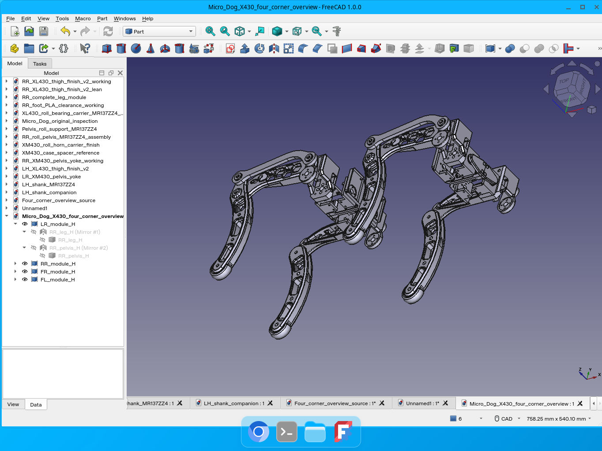

# dog — Micro_Dog X430

## 원작자 및 원본 소스

**원작자: © 2026 moieboy9999**  
**원본 소스 저장소: [moieboy9999/Micro_Dog](https://github.com/moieboy9999/Micro_Dog)**

이 저장소는 원본 Micro_Dog를 바탕으로 X430 모터에 맞춰 수정한 **파생 프로젝트**입니다. 원본 설계의 저작권은 원작자에게 있으며, 이 저장소가 원본 프로젝트이거나 원작자의 공식 배포·승인을 받은 프로젝트라는 의미는 아닙니다.

원본의 저작자 표시와 라이선스를 보존합니다. 기구·문서·메시·URDF·파라미터에는 **CC BY-NC-SA 4.0**, 소프트웨어 도구에는 **GPL-3.0-or-later**가 적용되며, ROBOTIS 등 제3자 자료의 권리는 별도로 존중합니다. 재배포·수정 시 [LICENSE](LICENSE), [LICENSE-SOFTWARE](LICENSE-SOFTWARE), [출처 및 수정 내역](ATTRIBUTION.md), [원본 저작자 표시](licenses/UPSTREAM_ATTRIBUTION.md), [제3자 고지](THIRD_PARTY_NOTICES.md)를 함께 확인하고 해당 조건을 따라 주세요.

Micro_Dog를 바탕으로 만든 X430 시험용 기구 프로젝트입니다. 다리 외형은 1.5배 확대하고, **XM430-W210 ×4 / XL430-W250 ×8**에 맞춰 모터 결합부·베어링·골반·좌우 부품을 수정했습니다.



## 현재 배포: 대퇴 v2

사용자 선택에 따라 RR/LH 대퇴 STL·STEP·편집 원본을 기존 v2로 복귀했습니다. v6는 Git 이력에 보존됩니다. 추가 구매 부품 변경은 없습니다.

[최종 Google Drive ZIP](https://drive.google.com/file/d/16QBDgSmI6tbEF90oM57XQGUR9OvJf8UD/view?usp=drivesdk) · 기존 접근 권한이 있는 Google 계정이 필요합니다.

## 먼저 보기

- [한국어 조립 설명서 PDF](docs/assembly/Micro_Dog_X430_Assembly_Manual_KO.pdf)
- [출력·조립 안내](docs/assembly/printing_and_assembly_KO.txt)
- [STL 출력 파일 18종](cad/stl/) · [STEP 18종](cad/step/)
- [FreeCAD 조립체](cad/freecad/assemblies/) · [개별 편집용 문서](cad/freecad/parts/)
- [출력물 BOM](docs/bom/printed_parts.csv) · [하드웨어 BOM](docs/bom/hardware.csv)
- [파라미터형 URDF 패키지](descriptions/micro_dog_x430_description/)
- [검증 범위와 한계](docs/VALIDATION.md) · [출처와 라이선스](ATTRIBUTION.md)

조립 설명서는 **REV 3**입니다. 일부 PDF 뷰어에서 한글 캡션이 깨지던 글꼴 임베딩 방식을 수정했습니다. Ghostscript와 PDFium으로 31쪽 전체를 각각 검토했고 Poppler 렌더링도 확인했습니다. REV 2의 그림·조립 내용은 그대로입니다. [재생성 방법](docs/REBUILD_MANUAL.md)과 [소스·그림·고정 메시 입력](docs/assembly/manual_v2/)도 포함합니다. 기구 형상은 변경하지 않았습니다.

## 현재 범위

출력물은 18종, 네 다리 기준 총 84개입니다. PLA 프레임과 TPU 95A 발을 기준으로 합니다. STL/STEP 치수는 mm이며 **100% 배율**로 사용합니다. 이미 확대된 파일을 다시 1.5배 하지 마세요.

중앙 몸체는 제작 완료된 CAD가 아닙니다. URDF 중앙 박스는 몸체 치수·다리 간격을 바꿔 볼 수 있는 파라미터 모델이며, 확정된 프레임·전장·배선·보행 제어기가 아닙니다. 모터 ID, 실물 영점, 토크 설정, 보행 정책은 포함하지 않습니다.

먼저 한 다리만 시험 출력·조립하세요. 명목 CAD와 메시 검사는 실물 공차, 강도·피로·충격, 전체 동작 범위, 케이블 수명 시험을 대신하지 않습니다. 조립 시 전원을 끄고 케이블과 공구 접근을 먼저 확인하세요.

## 파일 구성

```text
cad/freecad/assemblies/  RR 완성 다리와 4모서리 배치 조립체
cad/freecad/parts/       선택한 최종 부품 작업 문서 (편집 이력/참고 객체 포함 가능)
cad/step/               출력 부품의 교환용 최종 형상
cad/stl/                매니페스트와 일치하는 최종 출력 메시
descriptions/           파라미터형 로봇 설명, 메시, 생성/검사 도구
docs/assembly/          PDF, 단계별 순서, 체결부 치수/공구 접근 검토
docs/bom/               출력물 해시·수량·재질과 선정 하드웨어
images/                 실제 CAD 기반 조립 그림
tools/                  큰 파일 복원 및 배포 파일 검사
```

FreeCAD 작업 문서의 숨긴 중간 형상까지 출력하지 마세요. 제조 기준은 `cad/stl/`, `cad/step/`, `docs/bom/print_manifest.json`입니다. `docs/CAD_SOURCES.md`에 대응 관계를 기록했습니다. 큰 ZIP 중복본과 임시·백업 파일은 제외했습니다.

## 큰 파일 복원

업로드 전송 한도 때문에 대퇴 STL 두 개는 `.stl.gz`, 오른쪽 대퇴 FreeCAD 원본 한 개는 `.FCStd.part001`/`.part002`로 손실 없이 보관했습니다. 아래 복원 명령은 SHA-256을 확인한 뒤 원래 파일명으로 복구합니다. 다른 STL/STEP 및 URDF 메시는 바로 사용할 수 있습니다.

## 검사

```sh
python tools/restore_packed_files.py
python tools/validate_release.py
```

URDF 생성·RViz 확인·관절 검증은 [패키지 README](descriptions/micro_dog_x430_description/README_KO.md)를 따르세요. 이 저장소는 기존 `main` 이력을 보존한 업데이트입니다.

## License / attribution

원본: [Micro_Dog](https://github.com/moieboy9999/Micro_Dog), © 2026 moieboy9999. 원본 및 파생 기구/문서/메시/URDF/파라미터는 **CC BY-NC-SA 4.0**, 별도 소프트웨어 도구는 **GPL-3.0-or-later**입니다. ROBOTIS 모터·혼 등 제3자 참고 형상은 이 라이선스로 재허가하지 않습니다. [ATTRIBUTION.md](ATTRIBUTION.md), [THIRD_PARTY_NOTICES.md](THIRD_PARTY_NOTICES.md), [LICENSE](LICENSE), [LICENSE-SOFTWARE](LICENSE-SOFTWARE)를 확인하세요.
