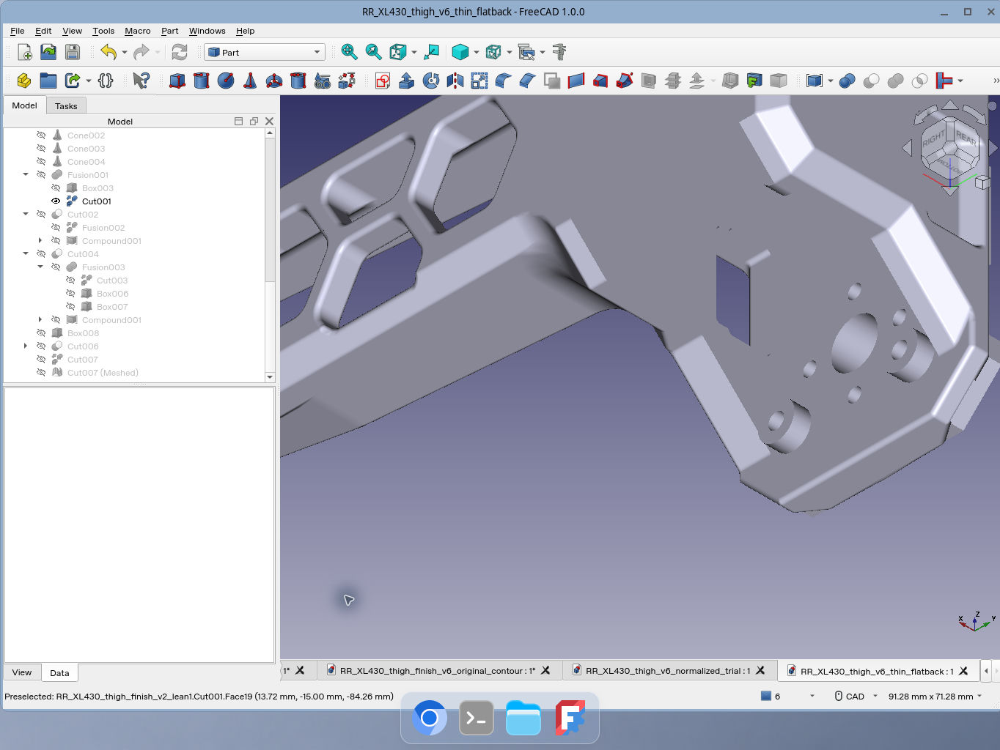
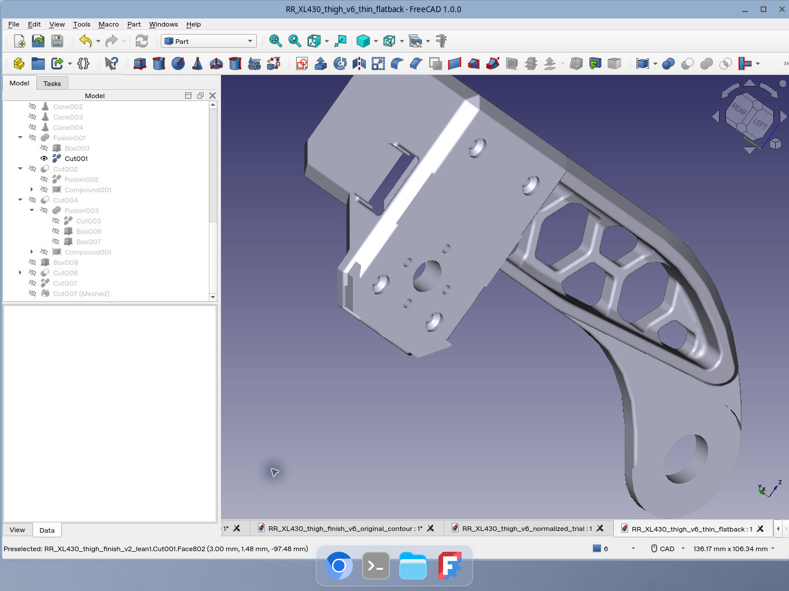
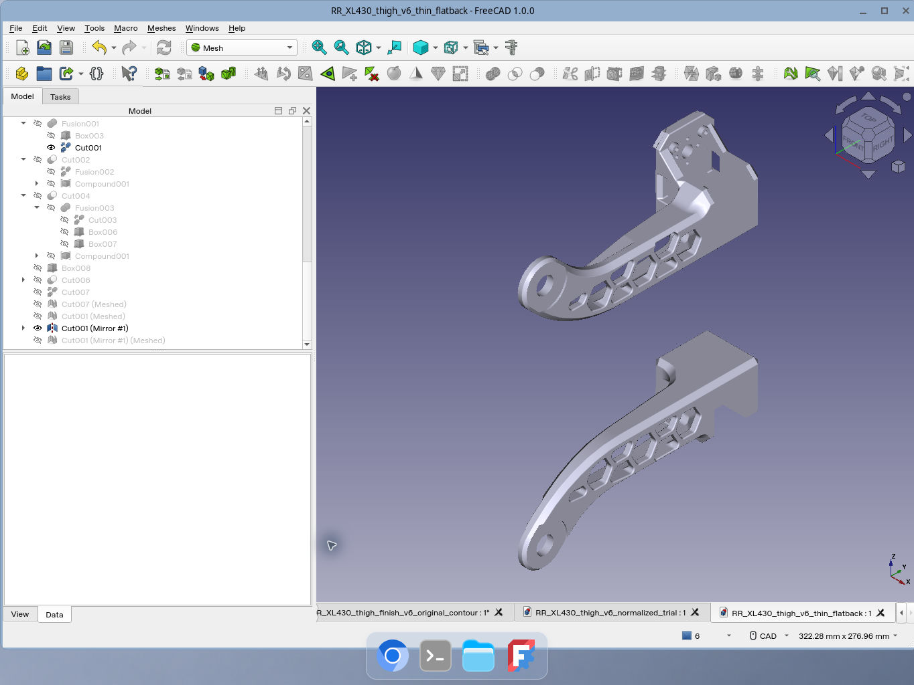

# 대퇴 v6 얇은 평면 뒤쪽 정리

기존 형상을 정리한 검증 버전입니다. 접합부 전체의 새 로프트 재설계는 이 배포에 포함하지 않습니다.

RR/LH 대퇴의 앞쪽 원본 윤곽을 복구하고 뒤쪽을 평평하게 정리했습니다. 최종 출력 파일은 `cad/stl/*_XL430_thigh_finish_v6_fine005.stl`, 교환 형상은 `cad/step/*_XL430_thigh_finish_v6.step`입니다. 기존 v2 대퇴 파일을 대체하며 v3/v4/v5 시험 형상은 배포하지 않습니다.

## 추가 구매 변경 없음

이번 형상 변경으로 추가 구매해야 하는 부품이나 수량 변경은 없습니다. 기존 M2.5 × 20, M2 × 8 체결부와 4개 패드, 별도 키드 스페이서를 유지합니다. [하드웨어 BOM](bom/hardware.csv)은 그대로이며, [출력물 BOM](bom/printed_parts.csv)은 대퇴 파일명과 해시만 갱신했습니다. 출력물은 여전히 18종, 84개입니다. 실물 시험 조립으로 공차와 체결 상태를 확인하세요.

## 편집 원본과 참고 자료

`cad/freecad/parts/RR_XL430_thigh_v6_thin_flatback.FCStd`는 RR `Cut001` 및 LH `Part__Mirroring`을 포함하는 한 문서입니다. 큰 파일 복원 도구 실행 후 여세요. 숨긴 이전 형상이나 전체 문서를 일괄 출력하지 마세요.

기존 FreeCAD 조립체, URDF 메시, PDF REV 3의 조립 그림은 v2 형상 참고 자료로 유지됩니다. 이번 작업에서 그것들을 v6 형상으로 갱신하지 않았습니다. 조립 순서와 체결 부품은 유지되며, 설명서의 v2 대퇴 파일명은 대응하는 v6 제조 파일로 읽으세요. 제조 기준은 현재 STL/STEP와 print_manifest.json입니다.

CAD/메시 검사는 실물 강도·피로·동작 범위 시험을 대체하지 않습니다.

## 디지털 형상 검사

RR/LH STEP는 각각 유효한 단일 솔리드(802면), STL은 각각 연결된 수밀 메시(RR 79,972 / LH 79,978 삼각형)입니다. LH는 원본 RR의 Z=0 대칭입니다. STEP/STL 간 완전한 표면 편차 상한이나 실물 적합성을 증명한 것은 아닙니다.

[상세 형상·체결 검사 및 한계](THIGH_V6_QA.txt)

